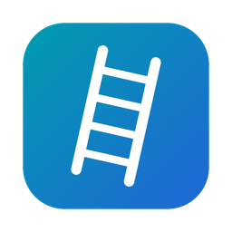
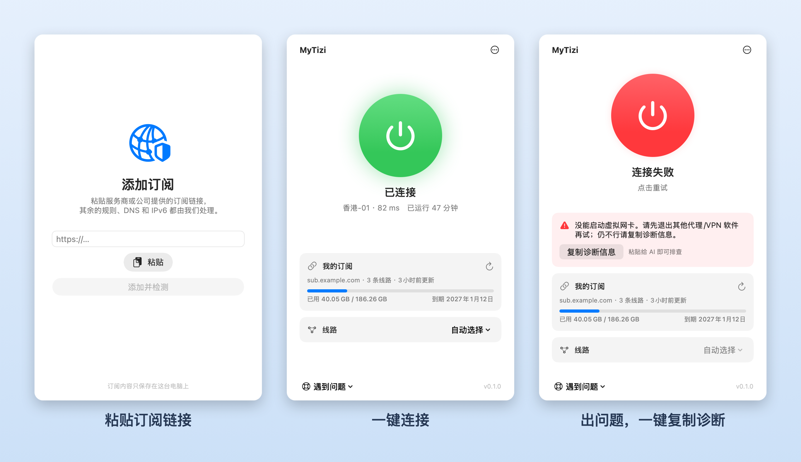

<p align="center"></p>

<h1 align="center">MyTizi</h1>

<p align="center">粘贴一个订阅链接，点一下就连上。<br>规则、DNS、IPv6、国内 CDN，都不用你管。</p>

<p align="center">
  <picture>
    <source media="(prefers-color-scheme: dark)" srcset="docs/images/screenshot-dark.png">
    
  </picture>
</p>

## 特点

- **只要一个订阅链接**：Clash 配置和通用 base64 链接（ss / vmess / vless / trojan / hysteria2 …）都支持。
- **TUN 全局接管**：国内平台及其 CDN 直连，其余走代理，内置 GeoIP / GeoSite 兜底，无需联网下载数据库。
- **自动处理 IPv6 和 DNS**：连接时关闭 IPv6、接管 DNS，断开或意外退出后自动恢复。
- **出问题一键复制诊断信息**：自带自动结论和实机自检，已脱敏，直接粘贴给 AI 即可排查。

## 安装

1. 到 [Releases](https://github.com/kadaliao/mytizi/releases) 下载 `MyTizi-x.y.z.dmg`，把 MyTizi 拖进「应用程序」。
2. 首次打开若提示"无法验证开发者"：进入「系统设置 → 隐私与安全性」，点一次「仍要打开」。
3. 粘贴订阅链接，点中间的大按钮。第一次连接会请求一次管理员授权，用来安装后台组件，之后不再询问。

需要 macOS 13 或更新，Apple 芯片和 Intel 都支持。请不要同时运行其他会开 TUN 的代理软件（Clash Verge 等），它们会抢路由和 DNS。

## 遇到问题

点窗口底部的「遇到问题 → 复制诊断信息」（或 `⌘⇧C`），粘贴给 AI 或同事。需要最近的连接日志时选「复制完整诊断」（含访问过的域名，发送前请自行确认）。

没有图形界面时：`MyTizi.app/Contents/MacOS/MyTizi --diagnose`。日志在 `/Library/Logs/MyTizi/` 和 `~/Library/Logs/MyTizi/`。

高级用户可以在「⋯ → 高级设置 → 编辑自定义规则」里加规则，格式 `DOMAIN-SUFFIX,example.com,PROXY`（目标可写 `PROXY` / `DIRECT` / `REJECT`）。

## 开发

需要 macOS 13+ 和 Xcode。

```sh
scripts/fetch-core.sh                 # 下载并校验内置 mihomo 与地理库
swift test                            # 测试
ARCHS=arm64 scripts/build-app.sh      # 打包本机架构 → dist/MyTizi.app
DMG=1 scripts/build-app.sh            # 通用二进制 + dmg
```

设计取舍见 [docs/DESIGN.md](docs/DESIGN.md)，真机回归清单见 [docs/TESTING.md](docs/TESTING.md)。

## 许可证

MyTizi 以 [MIT 许可证](LICENSE) 发布。

打包后的 App 内置了 [mihomo](https://github.com/MetaCubeX/mihomo)（GPL-3.0）和 [meta-rules-dat](https://github.com/MetaCubeX/meta-rules-dat) 的地理数据库，它们保留各自的许可证，详见 [THIRD_PARTY_NOTICES.md](THIRD_PARTY_NOTICES.md)；许可证全文随 App 附带在 `Contents/Resources/licenses/`。它们在构建时下载，不包含在本仓库里。
