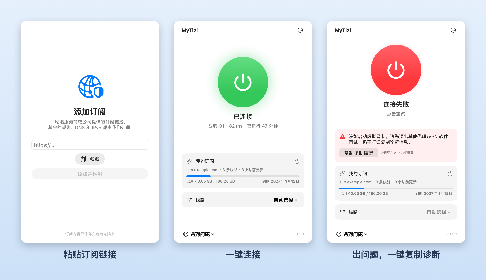

<p align="center"></p>

<h1 align="center">MyTizi</h1>

<p align="center">粘贴一个订阅链接，点一下就连上。<br>规则、DNS、IPv6、国内 CDN，都不用你管。</p>

<p align="center">
  <picture>
    <source media="(prefers-color-scheme: dark)" srcset="docs/images/screenshot-dark.png">
    
  </picture>
</p>

## 特点

- **只要一个订阅链接**：Clash 配置和通用 base64 链接（ss / vmess / vless / trojan / hysteria2 …）都支持。
- **TUN 全局接管**：国内平台及其 CDN 直连，其余走代理，内置 GeoIP / GeoSite 兜底，无需联网下载数据库。
- **自动处理 IPv6 和 DNS**：连接时关闭 IPv6、接管 DNS，断开或意外退出后自动恢复。
- **出问题一键复制诊断信息**：自带自动结论和实机自检，已脱敏，直接粘贴给 AI 即可排查。
- **会检查新版本，但不会偷偷替换自己**：每天看一次 GitHub Releases，主界面提示后由你手动下载覆盖（ad-hoc 签名无法安全自更新）。

## 安装

### macOS

1. 到 [Releases](https://github.com/kadaliao/mytizi/releases) 下载 `MyTizi-x.y.z.dmg`，把 MyTizi 拖进「应用程序」。
2. 首次打开若提示"无法验证开发者"：进入「系统设置 → 隐私与安全性」，点一次「仍要打开」。
3. 粘贴订阅链接，点中间的大按钮。第一次连接会请求一次管理员授权，用来安装后台组件，之后不再询问。

需要 macOS 13 或更新，Apple 芯片和 Intel 都支持。

### Windows

1. 到 [Releases](https://github.com/kadaliao/mytizi/releases) 下载 `MyTizi-x.y.z-windows-x64-setup.exe`（ARM 版 Windows 选 `arm64`）。
2. 双击安装。安装包没有代码签名，如果弹出「Windows 已保护你的电脑」，点「更多信息 → 仍要运行」。安装时授权一次管理员权限，用来注册后台服务 `MyTiziHelper`，之后不再询问。
3. 打开 MyTizi，粘贴订阅链接，点中间的大按钮。关掉窗口后 MyTizi 留在任务栏右下角的托盘里，左键点图标重新打开。

需要 64 位 Windows 10 或 11。杀毒软件有时会把内置的 mihomo 核心误报成风险程序，导致"无法启动内置核心"：把 `C:\Program Files\MyTizi` 加入信任即可。卸载在「设置 → 应用」里找 MyTizi，会一并删除后台服务，订阅与设置保留在 `%APPDATA%\MyTizi`。

### 两个平台通用

请不要同时运行其他会开 TUN 的代理软件（Clash Verge 等），它们会抢路由和 DNS。Tailscale 可以一起用：不要启用它的 exit node，管理后台的 DNS 页也不要开「Override DNS servers」（MagicDNS 可以保留）。

## 遇到问题

点窗口底部的「遇到问题 → 复制诊断信息」（macOS 也可以按 `⌘⇧C`；Windows 也可以在托盘图标的右键菜单里点），粘贴给 AI 或同事。需要最近的连接日志时选「复制完整诊断」（含访问过的域名，发送前请自行确认）。

没有图形界面时：

- macOS：`MyTizi.app/Contents/MacOS/MyTizi --diagnose`。日志在 `/Library/Logs/MyTizi/` 和 `~/Library/Logs/MyTizi/`。
- Windows：`& "C:\Program Files\MyTizi\MyTizi.exe" --diagnose | Out-File diag.txt`。日志在 `C:\ProgramData\MyTizi\logs\` 和 `%LOCALAPPDATA%\MyTizi\Logs\`。

高级用户可以在「⋯ → 高级设置 → 编辑自定义规则」里加规则，格式 `DOMAIN-SUFFIX,example.com,PROXY`（目标可写 `PROXY` / `DIRECT` / `REJECT`）。

## 开发

macOS 版需要 macOS 13+ 和 Xcode：

```sh
scripts/fetch-core.sh                 # 下载并校验内置 mihomo 与地理库
swift test                            # 测试
ARCHS=arm64 scripts/build-app.sh      # 打包本机架构 → dist/MyTizi.app
DMG=1 scripts/build-app.sh            # 通用二进制 + dmg
```

Windows 版在 `windows/`（Go），在 macOS 或 Linux 上就能交叉编译出安装包，见 [windows/README.md](windows/README.md)：

```sh
cd windows
go test ./...                         # 测试（会用 Vendor/core 里的真实 mihomo）
VERSION=0.4.0 scripts/build.sh        # → windows/dist/MyTizi-0.4.0-windows-{x64,arm64}-setup.exe
```

设计取舍见 [docs/DESIGN.md](docs/DESIGN.md)，真机回归清单见 [docs/TESTING.md](docs/TESTING.md)。

## 许可证

MyTizi 以 [MIT 许可证](LICENSE) 发布。

打包后的 App（两个平台都是）内置了 [mihomo](https://github.com/MetaCubeX/mihomo)（GPL-3.0）和 [meta-rules-dat](https://github.com/MetaCubeX/meta-rules-dat) 的地理数据库，它们保留各自的许可证，详见 [THIRD_PARTY_NOTICES.md](THIRD_PARTY_NOTICES.md)；许可证全文随 App 附带在 `Contents/Resources/licenses/`（Windows：安装目录下的 `licenses\`）。它们在构建时下载，不包含在本仓库里。
